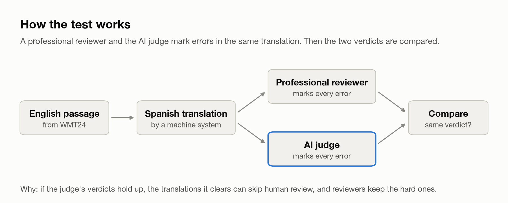
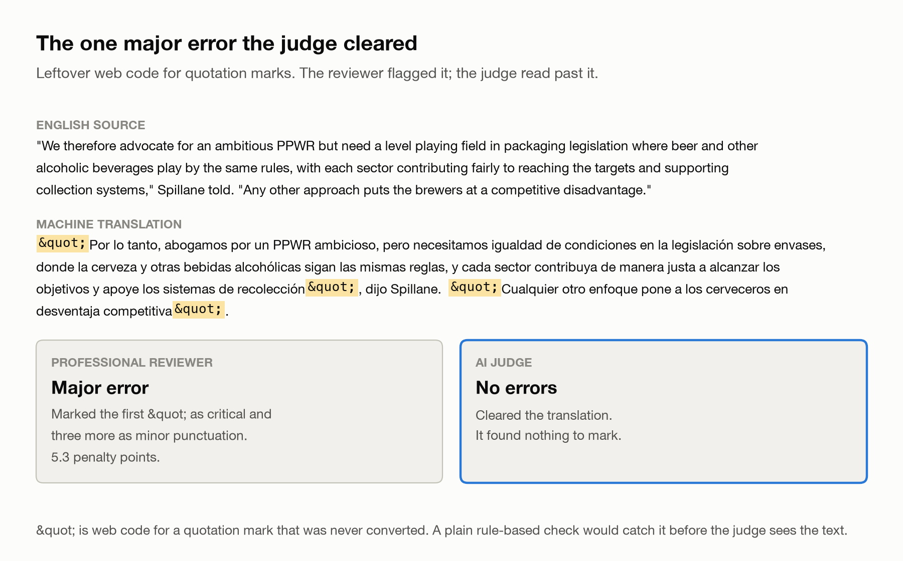
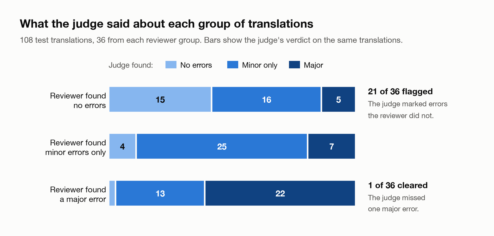
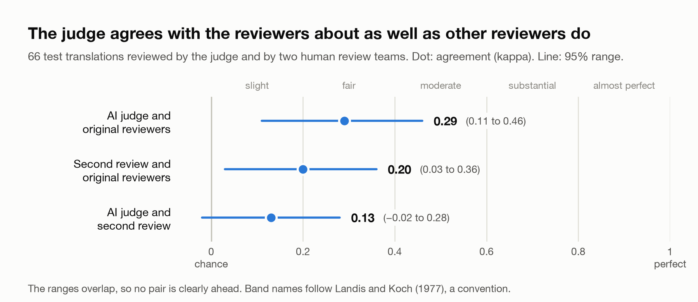

# Can an AI review translations like a professional?

A small test of whether an LLM judge finds translation errors the way
professional reviewers do, and where it can and can't be trusted.

  <picture>
    <source media="(prefers-color-scheme: dark)" srcset="docs/assets/how-it-works-dark.png">
    
  </picture>

## The question

Translation teams check AI-translated content by hand, which is slow and
expensive. Having an AI do the first pass would help, but only if its checks
are reliable. This project measures that on English to Spanish, using expert
reviews as the yardstick.

## Background: the data

### Where the data come from

| | |
|---|---|
| Event | WMT24, the Ninth Conference on Machine Translation, November 2024. Teams submit translation systems, and people review the output |
| What was collected | 622 English passages (news, literary, social media, speech), each translated into Spanish by 15 systems: 9,330 translations. Professional reviewers marked every error in each one. Four reviewers; each translation was reviewed once |
| Why it was collected | To test automatic translation metrics against human judgement (the WMT24 metrics task) |
| Where it is | [github.com/google/wmt-mqm-human-evaluation](https://github.com/google/wmt-mqm-human-evaluation), Apache 2.0 |
| Which Spanish | Mexico. The metrics paper says "the testset is for Spanish from Mexico rather than Spanish from Spain" (Freitag et al. 2024, section 3.2) |
| Paper that describes it | Freitag et al. 2024 |

### How this project uses the data differently

The organisers collected the reviews to score automatic metrics. This project
reuses them to ask a different question: **can an AI judge take the first
pass of translation review, and how far can its verdicts be trusted?**

The collection was not designed for that, which shaped two choices:

| Design choice in the original collection | What it means here |
|---|---|
| Each translation was reviewed by one person | A reviewer's strictness cannot be separated from the translation's quality without a second review |
| Reviewers saw the surrounding passages | The judge was given up to five neighboring passages on each side, in English and Spanish, and told to mark errors only in the passage under review |

### What MQM is

MQM (Multidimensional Quality Metrics) is a way for a person to review a
translation by marking the errors in it.

| | |
|---|---|
| Introduced | Lommel et al. 2014; adapted for machine translation research by Freitag et al. 2021 |
| What the reviewer marks | Each error span, its category (for example mistranslation, omission, grammar) and its severity (minor, major, critical) |
| Where the score comes from | Penalty points computed from the errors with fixed weights. This project uses the WMT24 weights: minor 1, minor punctuation 0.1, major 5, critical 5, not a translation 25 |
| How this project groups translations | No errors, minor errors only, or at least one major error (critical counts as major, as in the WMT papers) |

The second review used in "How reliable is the yardstick?" follows a lighter
scheme, ESA (Error Span Annotation, Kocmi et al. 2024b): the reviewer marks
each error span as minor or major, with no category, then gives a score from
0 to 100. It was collected for the WMT24 general translation task on the same
systems and passages. The two reviews are compared at the level they share:
no errors, minor only, or major.

## The test set: how it was picked and what it can show

### How it was picked

108 translations, drawn by `src/sample.py` with a fixed seed so the same set
comes out every time.

| Choice | Why |
|---|---|
| Equal groups: 36 with no errors, 36 with minor errors only, 36 with a major error | 81% of translations have no errors and 6% have a major one. A random draw of 108 would contain about 6 or 7 major-error translations, too few to say anything about misses. Results are reweighted back to the real shares afterwards |
| 9 from each of the four reviewers in every group | One reviewer flagged 36% of translations and the others 13% to 16%. Spreading each group evenly across reviewers keeps one reviewer's strictness from deciding the result |
| Machine systems only | The human reference translation and one broken system (MSLC) were left out, so the test is about ordinary machine output |
| 108 in total | Chosen to keep the judge run inside a 5 dollar budget and to divide evenly into 3 groups and 4 reviewers. It was not set by a power analysis beforehand |

The 108 cover 96 different source passages and 13 systems.

Sampling by group and then reweighting is standard stratified sampling
(Cochran, Sampling Techniques, 1977; cited from memory). Balancing across
reviewers is blocking on a factor that is known to matter but is not the
thing being tested.

### What 36 per group can and cannot show

Worked out after the test, with exact binomial limits (Clopper and Pearson,
1934). Exact limits are used because the counts are small and the
normal approximation is unreliable near zero. The 95% level is convention.

**Missed major errors (1 of 36)**

| Question | Answer |
|---|---|
| What the result supports | A miss rate under 12.5%, with 95% confidence (one-sided) |
| If the judge really missed 15% of major errors, how often would it show 1 miss or fewer in 36? | 2% of the time. The test had about 98% power to expose a judge that bad |
| If it really missed 10%? | 11% of the time. About 89% power |
| If it really missed 5%? | 46% of the time. The test cannot tell 5% from 10% |

| To claim a miss rate under | Major-error cases needed with 0 misses | With 1 miss |
|---|---|---|
| 10% | 29 | 46 |
| 5% | 59 | 93 |

**Share of translations the judge can clear (35%)**

| Question | Answer |
|---|---|
| Range | 22% to 49% (bootstrap); the textbook formula for a stratified sample gives about plus or minus 13 points, which agrees |
| Where the uncertainty comes from | 99% of it comes from the no-errors group, because that group stands for 81% of the data but has only 36 cases |
| What would halve the range | About four times as many no-errors cases (144), with the other groups unchanged |

The two questions pull in opposite directions. Equal groups are the right
design for the miss rate, and a larger no-errors group is the right design
for the clear rate. A follow-up test should size each group for the question
it answers: at least 59 major-error cases (93 to allow one miss) and about
144 no-errors cases.

## Results

**The AI judge could clear about a third of translations with no human
review, and it let through only 1 of 36 translations with a major error.**

| Finding | Result |
|---|---|
| Translations the judge cleared as error-free | 35% (95% range 22% to 49%) |
| Of those, ones a reviewer had marked with any error | 4.7% |
| Translations with a major error that the judge cleared | 1 of 36 |
| Share of translations each reviewer marked with an error | 36% for one reviewer, 13% to 16% for the other three |

What this means:

- **The judge can take the easy work off reviewers.** Translations it clears
  rarely had errors. Everything else goes to a human.
- **Its one major miss was mechanical.** Leftover web code (`&quot;`) in the
  translation. A plain rule-based check would catch it before the AI sees it.
- **It flags too much.** It marked errors in 21 of 36 translations the
  reviewer had passed. Some are real catches, some are nitpicks. Telling them
  apart needs a third native reviewer. This is the next thing to fix, because
  every false flag costs reviewer time.
- **Reviewers disagree too.** One reviewer flagged far more than the others,
  and was the harshest of the four inside 10 of 14 translation systems, so it
  isn't just that they got worse translations. Any judge measured against a
  single reviewer inherits that reviewer's strictness.

  <picture>
    <source media="(prefers-color-scheme: dark)" srcset="docs/assets/one-miss-dark.png">
    
  </picture>

### How the judge and reviewers compared

108 test translations, 36 from each reviewer group (no errors, minor errors
only, a major error). Rows are what the reviewer found; columns are what the
judge found.

  <picture>
    <source media="(prefers-color-scheme: dark)" srcset="docs/assets/judge-vs-reviewers-dark.png">
    
  </picture>

| Reviewer found | Judge: no errors | Judge: minor | Judge: major |
|---|---|---|---|
| No errors | 15 | 16 | 5 |
| Minor only | 4 | 25 | 7 |
| Major | 1 | 13 | 22 |

The test used equal groups so each would have enough cases. The 35% figure
reweights them back to their real shares in the data (81% no errors, 13% minor
only, 6% major). The range comes from resampling the 108 translations 5,000
times.

### Limits

- English to Spanish (Mexico) only.
- 108 test translations, each scored by one reviewer.
- One model (Claude Opus 5.5) with one prompt, frozen before the test.
- The judge saw up to five neighboring passages on each side for context. The
  reviewers saw up to ten in all, so the two did not see exactly the same
  context.

## The short version

| Step | What was done | What it showed |
|---|---|---|
| 1. Build the judge | An AI judge for English to Spanish, tested against professional reviewers | Cleared about a third of translations. Missed 1 of 36 with a major error. |
| 2. Check the yardstick | Found a second professional review of the same translations | The two human teams agreed only slightly (kappa 0.09 across 4,928 translations). |
| 3. Compare all three | Judge and both reviews on the 66 test translations they share | The judge matched the original reviewers about as well as the second human team did, and cleared no major errors. |
| 4. Name the weakness | Looked at what the judge flagged that reviewers had passed | It flags too much. Safe but cautious, so it saves less reviewer time than it could. |

The most useful finding was how much the human reviewers disagreed with each
other, because that limits how well any judge can be evaluated.

## How reliable is the yardstick?

The same 2024 English to Spanish translations were reviewed a second time by
different professionals for the WMT24 shared task
(https://github.com/wmt-conference/wmt24-news-systems). That makes it possible
to compare two human reviews with each other, and both with the judge.

**Two human reviews of the same 4,928 translations**

| Measure | Result |
|---|---|
| Put the translation in the same group (no errors, minor only, major) | 56% |
| Agreement beyond chance (kappa) | 0.09 (95% range 0.07 to 0.12) |
| Translations the first review marked major that the second marked clean | 31% of 281 |
| Share flagged by the second review's two vendors | 15% and 67% |

Kappa runs from 0 (no better than chance) to 1 (perfect). Below 0.20 is
conventionally called slight agreement (Landis and Koch, 1977).

**Judge and both reviews on the 66 test translations all three covered**

  <picture>
    <source media="(prefers-color-scheme: dark)" srcset="docs/assets/yardstick-dark.png">
    
  </picture>

| Pair | Kappa | 95% range |
|---|---|---|
| Original reviewers and AI judge | 0.29 | 0.11 to 0.46 |
| Original reviewers and second review | 0.20 | 0.03 to 0.36 |
| AI judge and second review | 0.13 | -0.02 to 0.28 |

| Of the 22 translations the original reviewers marked major | Cleared as error-free |
|---|---|
| AI judge | 0 |
| Second human review | 5 |

The ranges overlap, so the claim is "about as well as a second human review",
not "better than".

### Three decisions behind the numbers

| Decision | Why |
|---|---|
| Stopped treating one reviewer as ground truth | One of four reviewers flagged 36% of translations, the others 13% to 16%. Two review teams agreed only slightly on the same text. A judge can only look as good as the yardstick it is measured against. |
| Sized the claim to the sample | 36 major-error cases with 1 miss supports "miss rate under about 12%" at 95% confidence (exact binomial). Claiming "under 5%" needs 59 cases with no misses, or 93 with one. |
| Did not pool data that was not comparable | Public ratings for other languages come from different years, vendors and review schemes. Each language is reported on its own. Russian (2022) was dropped because each reviewer rated exactly one text type, so reviewer and text type cannot be separated. |

### Weaknesses

- One language, a small sample, one judge prompt.
- The judge's extra flags could be real catches or nitpicks. This data cannot
  tell which.
- The second review was uneven. One vendor's reviewers flagged most of what
  they saw. Without that vendor, agreement between the two human reviews rises
  to 0.17 (0.13 to 0.21), still slight.
- The two reviews used different schemes (full MQM, and error spans with
  severity only), so this is agreement across schemes, not a standard
  inter-rater check.
- The scripts for this section are not in the repo yet, and the second
  review's data is not redistributed here because its repo states no license.

### What comes next

- Scale to more languages with the 2024 data, where the same translation
  systems were reviewed in eight languages from English, including
  lower-resource ones like Icelandic and Hindi.
- Move from "how often does the judge agree" to "the judge clears
  translations with a guaranteed maximum miss rate", with the sample sized for
  each language.

## How it was done

- **Explore the data** (`src/explore.py`). 11,345 marked errors across 9,330
  translations: 622 English passages, each translated by 15 systems.
- **Score every translation and check the reviewers** (`src/score.py`).
  Penalty points per WMT24: minor 1, minor punctuation 0.1, major 5,
  critical 5, not a translation 25. Then how often each reviewer marked
  errors, overall and inside each system. Overview page:
  [docs/step-2-penalty-scores.html](docs/step-2-penalty-scores.html)
  (download and open in a browser).
- **Pick the test set** (`src/sample.py`). 108 translations, 9 per reviewer
  per group.
- **Run the AI judge** (`src/judge.py`). Prompt frozen at v4, model pinned,
  answers cached.
- **Compare** (`src/compare.py`). The table above, the reweighted clear rate,
  and the range.

- **Draw the figures** (`src/figures.py`). The images in this README, in
  `docs/assets/`.

To reproduce: `src/get_data.py` downloads the ratings, then run the steps in
order. The judge step needs an Anthropic API key in `.env`.

## Outputs

The results are in `out/`, so you can read them without rerunning anything.

- [`out/judge_enes.csv`](out/judge_enes.csv): the judge's verdict on each of
  the 108 test translations, with every error it found, its severity, and the
  judge's explanation.
- [`out/sample_enes.csv`](out/sample_enes.csv): the same 108 translations with
  the reviewer's penalty points and group. Join it to the judge file on
  `seg_id`.
- [`out/segments_enes.csv`](out/segments_enes.csv): all 9,330 translations
  with their penalty points, error count and reviewer.

These files are built from Google's WMT24 MQM ratings
(https://github.com/google/wmt-mqm-human-evaluation), which are licensed under
Apache 2.0. The source passages, translations and reviewer ratings are
Google's. The penalty points and the judge's verdicts are this project's.

## Ideas for later

- **Rule-based checks before the AI.** A plain script that catches mechanical
  failures (web code like `&quot;`, chatbot replies instead of translations,
  text left in English, empty output) on all translations for free, so the AI
  judge only handles meaning. Measure it against the reviewers like the judge.
- **A panel of AI judges.** Several judges review each passage and their answers
  are combined, the way a human panel's would be. One version shapes each judge
  on a real reviewer's style (one strict, others lenient) and checks whether the
  panel beats a single judge.
- **A development set.** Tune the judge's instructions on passages outside the
  test set, then freeze them before the test.
- **Other language pairs.** Google's 2024 release covers more than English to
  Spanish; check whether the results hold.

## Literature

| Topic | Reference | Link |
|---|---|---|
| The MQM reviews used here | Freitag et al. 2024. Are LLMs Breaking MT Metrics? Results of the WMT24 Metrics Shared Task. WMT 2024 | [aclanthology.org/2024.wmt-1.2](https://aclanthology.org/2024.wmt-1.2/) |
| The second review | Kocmi et al. 2024a. Findings of the WMT24 General Machine Translation Shared Task. WMT 2024 | [aclanthology.org/2024.wmt-1.1](https://aclanthology.org/2024.wmt-1.1/) |
| ESA | Kocmi et al. 2024b. Error Span Annotation: A Balanced Approach for Human Evaluation of Machine Translation. WMT 2024 | [aclanthology.org/2024.wmt-1.131](https://aclanthology.org/2024.wmt-1.131/) |
| MQM, original framework | Lommel, Uszkoreit, Burchardt 2014. Multidimensional Quality Metrics (MQM). Tradumàtica 12 | Cited as in the WMT papers; not read for this project |
| MQM for machine translation | Freitag et al. 2021. Experts, Errors, and Context: A Large-Scale Study of Human Evaluation for Machine Translation. TACL | [aclanthology.org/2021.tacl-1.87](https://aclanthology.org/2021.tacl-1.87/) |
| An LLM marking MQM errors | Kocmi and Federmann 2023. GEMBA-MQM: Detecting Translation Quality Error Spans with GPT-4. WMT 2023 | [aclanthology.org/2023.wmt-1.64](https://aclanthology.org/2023.wmt-1.64/) |
| Ranges that respect grouped data | Miller 2024. Adding Error Bars to Evals | [arxiv.org/abs/2411.00640](https://arxiv.org/abs/2411.00640) |
| Exact limits for small counts | Clopper and Pearson 1934. The Use of Confidence or Fiducial Limits Illustrated in the Case of the Binomial. Biometrika 26 | Cited from memory; not re-read for this project |
| Stratified sampling | Cochran 1977. Sampling Techniques, 3rd ed. | Book; cited from memory |
| Reading kappa | Landis and Koch 1977. The Measurement of Observer Agreement for Categorical Data. Biometrics 33 | Source of the "slight agreement" label; a convention, not a test |
| Clearing with a guarantee (next step) | Jung, Brahman, Choi 2024. Trust or Escalate: LLM Judges with Provable Guarantees for Human Agreement | [arxiv.org/abs/2407.18370](https://arxiv.org/abs/2407.18370) |
